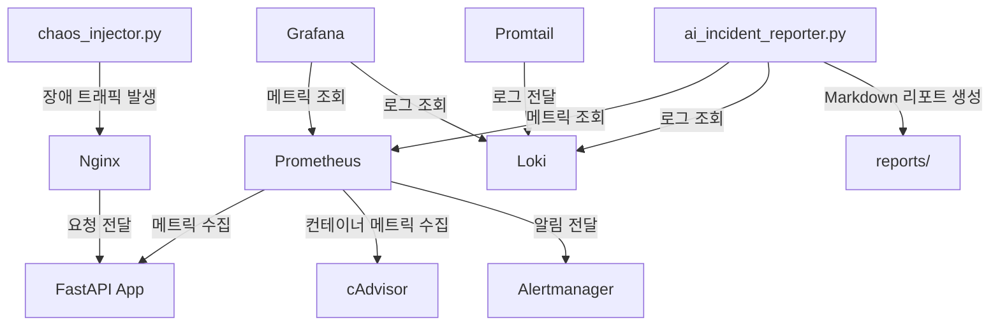
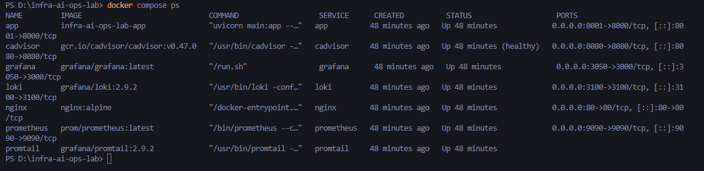
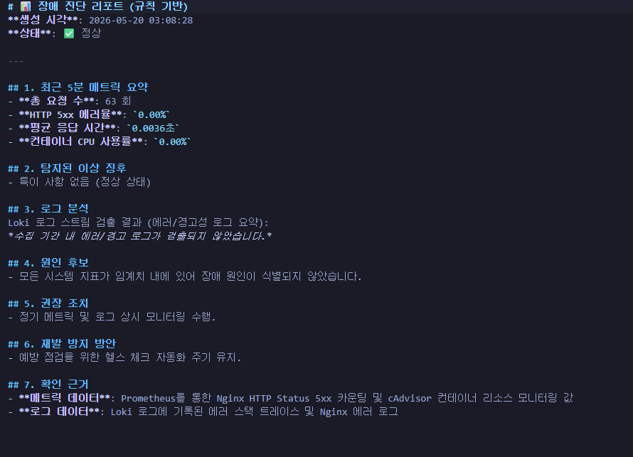
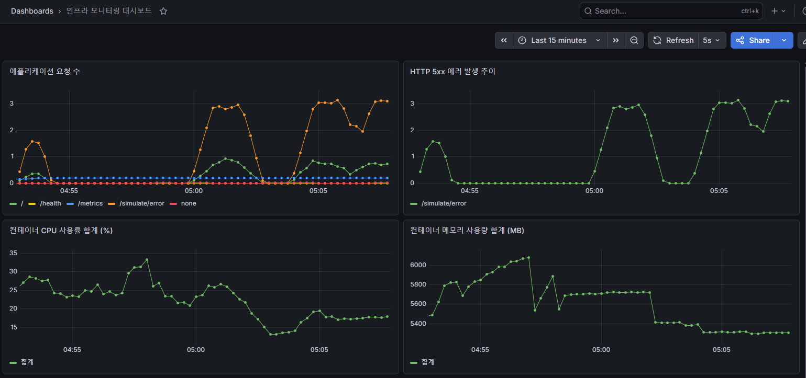
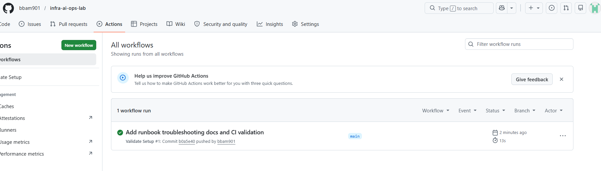

# infra-ai-ops-lab

[](https://github.com/bbam901/infra-ai-ops-lab/actions/workflows/validate.yml)

Docker Compose로 작은 웹 서비스와 모니터링 환경을 구성하고, 장애 상황을 직접 만들어 보면서 로그, 메트릭, 알림, 장애 리포트가 어떻게 이어지는지 학습한 개인 프로젝트입니다.

본 프로젝트는 실제 운영 서버가 아니라 로컬 실습 환경에서 진행했습니다. 실무 인프라 운영 환경을 가정하여 웹 서비스, 모니터링, 로그 수집, 장애 시나리오, 장애 리포트 자동화 흐름을 구성했습니다.

---

## 1. 만든 이유

인프라 직무를 준비하면서 단순히 서버를 실행하는 것보다, 문제가 생겼을 때 어떤 순서로 확인하고 대응하는지가 중요하다고 생각했습니다.

그래서 아래 흐름을 직접 만들어 보는 것을 목표로 했습니다.

- 웹 서비스와 Nginx reverse proxy 구성
- Prometheus로 애플리케이션 및 컨테이너 메트릭 수집
- Grafana로 수집된 메트릭 시각화
- Loki와 Promtail로 애플리케이션 로그 수집
- 장애 트래픽을 발생시키고 5xx 에러, 지연, CPU 부하 확인
- Prometheus Alert Rule과 Alertmanager로 알림 확인
- 수집된 로그와 메트릭을 바탕으로 장애 진단 리포트 생성

---

## 2. 구성도



---

## 3. 기술 스택

| 구분 | 사용 기술 |
| :--- | :--- |
| 웹 서비스 | FastAPI, Uvicorn |
| 프록시 | Nginx |
| 컨테이너 실행 | Docker Compose |
| 메트릭 수집 | Prometheus, cAdvisor |
| 알림 | Prometheus Alert Rule, Alertmanager |
| 로그 수집 | Loki, Promtail |
| 시각화 | Grafana |
| 자동화 스크립트 | Python, Requests |
| 선택 기능 | Gemini API 또는 rule-based 리포트 |

---

## 4. 실행 방법

### 1) 환경 변수 파일 준비

```bash
cp .env.example .env
```

Gemini API 키가 없어도 실행할 수 있습니다. 키가 없으면 rule-based 방식으로 장애 리포트를 생성합니다.

### 2) Python 패키지 설치

Windows에서 `pip` 명령이 안 될 경우 `python -m pip`를 사용합니다.

```bash
python -m pip install -r scripts/requirements.txt
```

### 3) Docker Compose 실행

```bash
docker compose up -d --build
```

상태 확인:

```bash
docker compose ps
```

---

## 5. 접속 주소

| 서비스 | 주소 | 확인 내용 |
| :--- | :--- | :--- |
| Nginx | http://localhost | FastAPI 앱 접근 |
| FastAPI | http://localhost:8001 | 앱 직접 접근 |
| Prometheus | http://localhost:9090 | 메트릭 및 Alert Rule 확인 |
| Alertmanager | http://localhost:9093 | 발생한 알림 확인 |
| Grafana | http://localhost:3050 | 대시보드 확인 |
| cAdvisor | http://localhost:8080 | 컨테이너 리소스 확인 |
| Loki | http://localhost:3100/ready | Loki API 상태 확인 |

Grafana 기본 계정:

```text
admin / admin
```

Loki는 별도의 웹 화면을 제공하는 서비스가 아니라 로그 저장소 API입니다. 따라서 `http://localhost:3100`으로 접속하면 404가 보일 수 있습니다. 상태 확인은 `http://localhost:3100/ready`에서 하고, 실제 로그 조회는 Grafana의 Explore 메뉴에서 Loki datasource를 선택해 확인합니다.

---

## 6. 장애 시나리오 실행

정상 트래픽:

```bash
python scripts/chaos_injector.py --mode normal --duration 30
```

HTTP 500 에러 발생:

```bash
python scripts/chaos_injector.py --mode error --duration 60
```

응답 지연 및 CPU 부하 발생:

```bash
python scripts/chaos_injector.py --mode latency --duration 60
```

여러 상황을 섞어서 실행:

```bash
python scripts/chaos_injector.py --mode mixed --duration 60
```

---

## 7. 장애 리포트 생성

장애 트래픽을 발생시킨 뒤 아래 명령을 실행합니다.

```bash
python scripts/ai_incident_reporter.py
```

스크립트는 Prometheus와 Loki에서 최근 메트릭과 로그를 조회한 뒤 `reports/` 폴더에 Markdown 리포트를 생성합니다.

리포트에는 다음 내용이 포함됩니다.

- 최근 요청 수
- HTTP 5xx 에러율
- 평균 응답 시간
- 관련 에러 로그
- 원인 후보
- 권장 조치
- 재발 방지 방안

예시 문서는 [reports/sample_incident_report.md](reports/sample_incident_report.md)에서 확인할 수 있습니다.

---

## 8. 실행 결과

### Docker Compose 서비스 상태



`app`, `nginx`, `prometheus`, `grafana`, `loki`, `promtail`, `cadvisor`, `alertmanager` 컨테이너가 정상 실행되는 것을 확인했습니다.

### Loki 로그 조회


Grafana Explore에서 Loki datasource를 선택하고 500 에러 로그가 수집되는 것을 확인했습니다.

### Prometheus 메트릭 확인


Prometheus에서 `up` 쿼리를 실행해 수집 대상이 정상 상태인지 확인했습니다.

### 한국어 장애 진단 리포트



장애 시나리오 실행 후 한국어 장애 진단 리포트가 생성되는 것을 확인했습니다.

### Alertmanager 알림 확인


Prometheus Alert Rule 조건이 만족되었을 때 Alertmanager에서 알림이 표시되는 것을 확인했습니다.

### Prometheus Alerts 확인


Prometheus Alerts 화면에서 등록된 alert rule 상태를 확인했습니다.

### Grafana 대시보드



요청 수, 5xx 에러 추이, 컨테이너 CPU/Memory 사용량, 로그 스트림을 Grafana에서 확인할 수 있도록 구성했습니다.

### 장애 대응 Runbook


장애가 발생했을 때 어떤 순서로 확인할지 정리한 Runbook을 작성했습니다.

### GitHub Actions 검증



GitHub Actions에서 `docker compose config`와 주요 설정 파일 존재 여부를 자동으로 확인하도록 구성했습니다.

### GitHub README 표시 확인


GitHub 저장소에서 README와 이미지가 정상적으로 표시되는지 확인했습니다.

---

## 9. 알림 규칙

Prometheus Alert Rule을 추가하여 장애 상황을 알림으로 확인할 수 있게 했습니다.

| 알림명 | 조건 | 목적 |
| :--- | :--- | :--- |
| High5xxErrorRate | HTTP 5xx 에러율 증가 | 애플리케이션 오류 증가 감지 |
| HighContainerCPUUsage | 컨테이너 CPU 사용률 증가 | 리소스 부하 감지 |

알림 테스트 방법:

```bash
python scripts/chaos_injector.py --mode error --duration 60
```

이후 아래 화면에서 알림 상태를 확인합니다.

- Prometheus Alerts: http://localhost:9090/alerts
- Alertmanager: http://localhost:9093

본 프로젝트는 로컬 실습 환경에서 알림을 쉽게 확인하기 위해 임계치를 낮게 설정했습니다. 실제 운영 환경에서는 서비스 트래픽과 운영 기준에 맞게 조정해야 합니다.

---

## 10. 문서

- [장애 대응 Runbook](docs/runbook.md)
- [트러블슈팅 가이드](docs/troubleshooting.md)

Runbook에는 HTTP 5xx 에러, 응답 지연, CPU 사용률 증가 상황에서 어떤 쿼리를 보고 어떤 순서로 확인할지 정리했습니다.

---

## 11. 겪었던 문제와 해결

프로젝트를 만들면서 아래 문제들을 직접 확인하고 수정했습니다.

- Windows 환경에서 `pip` 명령이 안 되어 `python -m pip`로 설치
- Loki가 `/tmp/loki` 경로 권한 문제로 실행되지 않아 저장 경로를 `/loki`로 변경
- Grafana provisioned dashboard는 UI에서 삭제할 수 없어 JSON 파일과 volume 상태를 확인
- Grafana 패널이 `No data`로 보여 Prometheus 실제 metric label에 맞게 PromQL 수정
- Nginx 502 응답이 발생했을 때 app 컨테이너 상태와 프록시 설정 확인
- README 이미지 링크와 GitHub Actions badge 링크 수정

---

## 12. 배운 점

- 컨테이너가 실행되는 것과 모니터링이 되는 것은 별개의 문제라는 점을 배웠습니다.
- 장애를 보기 위해서는 로그와 메트릭을 함께 확인해야 한다는 것을 알게 되었습니다.
- Grafana 화면만 보는 것이 아니라 Prometheus에서 직접 쿼리를 실행해 원인을 확인하는 과정이 중요했습니다.
- Alertmanager를 통해 문제가 발생했을 때 알림이 어떻게 전달되는지 실습했습니다.
- README와 Runbook을 작성하면서, 만든 기능을 다른 사람이 이해할 수 있게 설명하는 것도 중요하다는 것을 배웠습니다.

---

## 13. 개선하고 싶은 점

- 실제 데이터베이스를 연결해 DB 장애 시나리오 추가
- Alert Rule을 더 현실적인 기준으로 조정
- 리포트에 장애 발생 시점 전후의 타임라인 추가
- Grafana dashboard 패널을 더 보기 쉽게 개선
- 테스트 스크립트와 CI 검증 범위 확대

---

## 14. 프로젝트 성격

이 프로젝트는 개인 학습과 취업 포트폴리오를 목적으로 만든 로컬 실습 프로젝트입니다. 실제 운영 환경에 그대로 적용하기보다는, 인프라 운영에서 사용하는 모니터링, 로그 수집, 알림, 장애 대응 흐름을 이해하기 위한 목적으로 구성했습니다.
