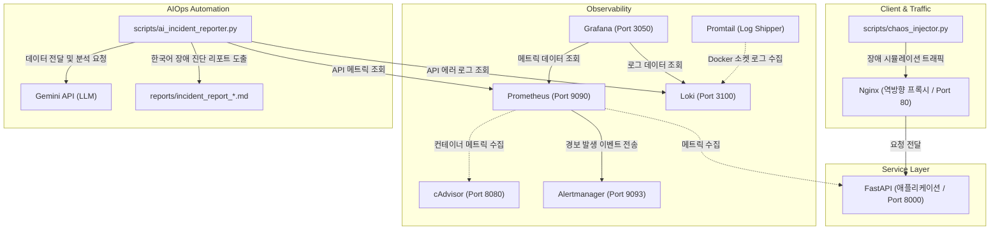
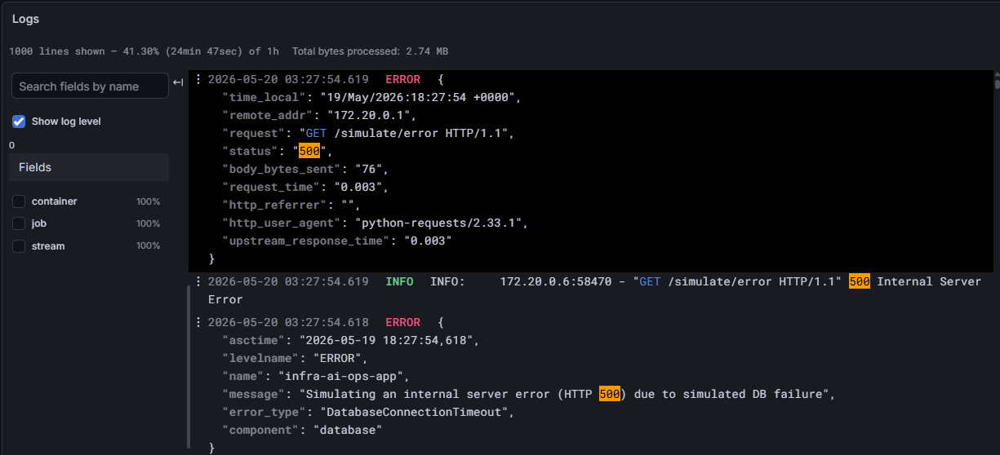
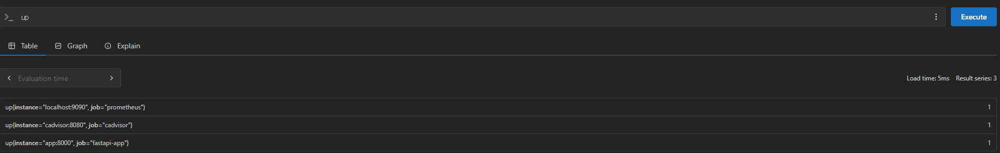
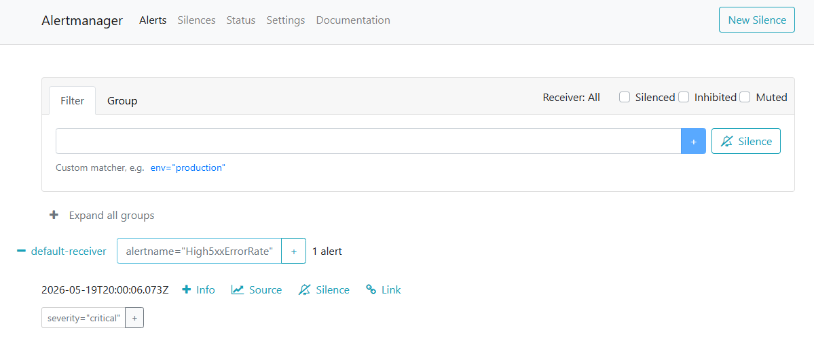
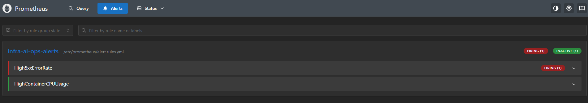
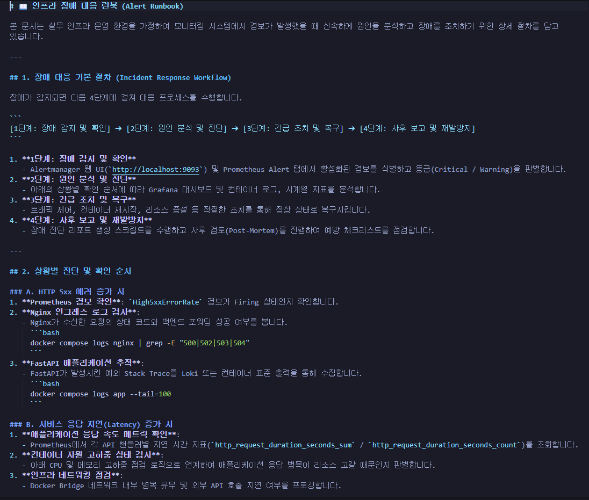
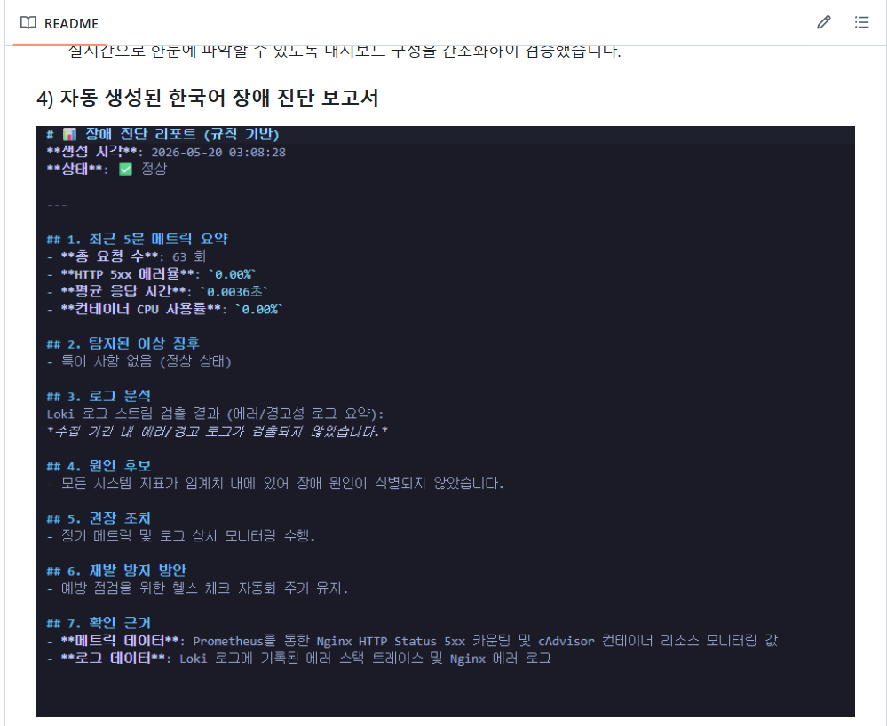

# infra-ai-ops-lab
[](https://github.com/bumku/infra-ai-ops-lab/actions/workflows/validate.yml)

> **SRE 관점의 학습 프로젝트: Docker Compose 기반 모니터링 및 AI/규칙 기반 장애 대응 자동화 랩**

본 프로젝트는 실무 인프라 운영 환경을 가정하여 진행한 개인 학습 프로젝트입니다.  
Docker Compose 기반으로 웹 서비스, 모니터링, 로그 수집, 장애 시나리오, 장애 리포트 자동화 흐름을 구성했습니다.  
실제 운영 서버가 아닌 로컬 실습 환경에서 장애 상황을 재현하고 관찰 가능성(Observability)과 장애 대응 흐름을 학습하는 것을 목표로 했습니다.

---

## 1. 프로젝트 목적 및 핵심 요약
- **관찰 가능성(Observability) 체득**: Prometheus와 Loki를 구축하여 메트릭과 로그를 수집·통합 시각화함으로써 실무 인프라의 장애 탐지 방식을 학습했습니다.
- **구조화된 로그 파이프라인 설계**: FastAPI 애플리케이션 및 Nginx의 로그 출력을 JSON 포맷으로 단일화하여, Promtail을 통해 Loki로 가공 없이 효율적으로 인덱싱되도록 구조를 최적화했습니다.
- **장애 시나리오 검증 및 자동 리포팅**: 트래픽 과부하, 지연, 서버 오류 시뮬레이션을 수행하고 Prometheus/Loki 데이터를 분석하여 장애의 원인을 짚어내는 진단서 생성 스크립트를 구현했습니다. 

---

## 2. 아키텍처 다이어그램



### 시스템 흐름
1. **장애 유발**: `chaos_injector.py`를 실행해 Nginx 관문을 거쳐 FastAPI로 정상 통신 혹은 장애 유도(500 에러, 지연, CPU 과부하) 트래픽을 보냅니다.
2. **지표/로그 수집**: cAdvisor가 컨테이너 성능(CPU/메모리)을 수집하고, Prometheus가 FastAPI 메트릭을 긁어갑니다(Scrape). 동시에 Promtail은 Docker 데몬의 소켓을 모니터링하여 로그를 Loki로 중앙 수집합니다.
3. **진단 및 리포팅**: `ai_incident_reporter.py` 실행 시 Prometheus와 Loki에서 최근 상태 정보를 동적으로 파악합니다. Gemini API 키가 활성화되어 있으면 AI 진단 리포트를 생성하며, 키가 없을 경우에는 자체 임계치와 로그를 조합해 정형화된 **규칙 기반(Rule-based)** 한국어 장애 보고서를 자동으로 작성합니다.

---

## 3. 기술 스택
- **웹 및 게이트웨이**: Nginx, FastAPI, Uvicorn
- **모니터링 및 메트릭**: Prometheus, cAdvisor, Alertmanager
- **중앙 로그 수집**: Loki, Promtail
- **데이터 시각화**: Grafana
- **자동화 스크립트**: Python 3.10+, Requests, Google GenAI SDK (Gemini-2.5-Flash)

---

## 4. 운영 및 대응 문서 (Documentation)
본 프로젝트는 장애 탐지, 전파 및 트러블슈팅의 전체 라이프사이클을 체계적으로 학습하기 위해 상세한 운영 문서를 제공합니다.

- 📖 **[장애 대응 런북 (Alert Runbook)](docs/runbook.md)**: 실무 수준의 경보 발생 시 1~4단계 대응 프로토콜 및 Prometheus / Loki 원시 분석 쿼리 가이드
- 🛠️ **[운영 트러블슈팅 가이드 (Troubleshooting Guide)](docs/troubleshooting.md)**: Docker 권한 에러, Grafana 대시보드 덮어쓰기 오작동, Nginx 게이트웨이 지연 대응 방안

---

## 5. 시작하기 및 실행 방법

### 사전 준비사항
- Docker 및 Docker Compose가 설치되어 있어야 합니다.
- 스크립트 구동을 위해 Python 3.10 이상 버전이 설치되어 있어야 합니다.

### 1) 환경 변수 설정
프로젝트 루트 폴더에 `.env` 파일을 구성합니다. (Gemini API 키가 준비되어 있지 않아도 룰 기반의 분석기가 자동 작동하여 리포트가 생성됩니다.)

```bash
# .env.example 복사
cp .env.example .env
```

`.env` 구성 정보 예시:
```env
GEMINI_API_KEY=your_gemini_api_key_here
PROMETHEUS_URL=http://localhost:9090
LOKI_URL=http://localhost:3100
FASTAPI_URL=http://localhost
```

### 2) 서비스 기동 (Docker Compose)
도커 컴포즈 명령을 활용해 백그라운드에서 컨테이너 환경을 빌드하고 실행합니다.
```bash
docker compose up -d --build
```

### 3) 서비스 접속 포트 정보
모든 컨테이너가 정상 구동되면 브라우저를 통해 아래 주소로 대시보드 및 지표 상태를 관찰할 수 있습니다.

| 서비스명 | 역할 | 로컬 접속 URL | 비고 |
| :--- | :--- | :--- | :--- |
| **Nginx** | 시스템 인그레스 관문 (80 포트) | [http://localhost](http://localhost) | FastAPI `/` 기본 화면 반환 |
| **FastAPI App** | 웹 서비스 호스트 포트 바인딩 | [http://localhost:8001](http://localhost:8001) | API 문서 조회: `/docs` |
| **Prometheus** | 시계열 메트릭 데이터베이스 콘솔 | [http://localhost:9090](http://localhost:9090) | 수집 대상(Targets) 활성 상태 점검 |
| **Alertmanager** | 경보(Alert) 상태 모니터링 및 관리 도구 | [http://localhost:9093](http://localhost:9093) | Prometheus 연동 알림 UI |
| **Grafana** | 모니터링 대시보드 시각화 도구 | [http://localhost:3050](http://localhost:3050) | 로그인 계정 정보: `admin` / `admin` |
| **cAdvisor** | 실시간 컨테이너 리소스 모니터링 | [http://localhost:8080](http://localhost:8080) | 각 컨테이너 세부 메모리/CPU 사용 정보 |
| **Loki** | 중앙 집중 로그 저장소 API | [http://localhost:3100](http://localhost:3100) | 로그 통신 백엔드 |

---

## 6. 장애 시뮬레이션 시나리오 실행

실습용 Python 패키지 라이브러리를 먼저 설치합니다.
```bash
pip install -r scripts/requirements.txt
```

`chaos_injector.py` 스크립트를 사용하여 다양한 성격의 트래픽을 주입하여 장애 상황을 인위적으로 학습해볼 수 있습니다.

### A. 정상 트래픽 발생
서비스에 정상 상태의 요청들을 유도하여 일반 지표 추이를 그립니다.
```bash
python scripts/chaos_injector.py --mode normal --duration 30
```

### B. HTTP 500 오류 대량 발생
데이터베이스 연결 지연 등 가상의 오류 응답을 강제하여 에러 로그 적재 추이를 관측합니다.
```bash
python scripts/chaos_injector.py --mode error --duration 60
```

### C. 서비스 지연 및 CPU 과부하 상황 유도
스레드 대기 현상 또는 루프 로직에 의한 급격한 시스템 자원 고갈 현상을 유도합니다.
```bash
python scripts/chaos_injector.py --mode latency --duration 60
```

### D. 복합적 복합 장애 상황 시뮬레이션
동시에 여러 부하와 오류가 공존하는 복잡한 실무 환경의 장애 상태를 형성합니다.
```bash
python scripts/chaos_injector.py --mode mixed --duration 60
```

---

## 7. 장애 리포트 자동 도출 기법

장애 유입이 완료되거나 진행 중인 상태에서 진단 분석기를 작동시킵니다.
```bash
python scripts/ai_incident_reporter.py
```

### 자동 분석 순서
1. **메트릭 크롤링**: Prometheus API에서 지난 5분간 처리된 웹 트래픽 정보, HTTP 5xx 발생 비율, 응답 타임(Latency), 컨테이너별 CPU 사용 지표를 파싱합니다.
2. **로그 수집**: Loki API를 질의해 지난 10분간 에플리케이션 및 프록시 로그 스트림에서 매칭된 Warning/Error 로그들을 역순 정렬해 가져옵니다.
3. **리포트 작성**:
   - `GEMINI_API_KEY`가 활성화되어 있으면, 수집된 원시 정보들을 프롬프트 컨텍스트에 담아 Gemini에 전달하여 종합적인 분석을 요구합니다.
   - 키가 존재하지 않으면 사전에 구현된 이상 지표 패턴 분석 로직에 따라 매치되는 로그 분석 결과를 조합하여 Markdown 문서를 작성합니다.
4. **리포트 저장**: 생성물은 루트 폴더 내 `reports/` 하위에 고유 타임스탬프를 이름으로 하여 저장됩니다. (예: `reports/incident_report_20260520_031024.md`)

*※ 작성 완료된 한국어 장애 보고서 양식은 [보고서 샘플 양식](reports/sample_incident_report.md)을 참조해 주십시오.*

---

## 8. 실행 결과

본 실습 환경을 기동하고 장애 시뮬레이션을 작동했을 때 수집되는 지표와 로그, 그리고 생성된 보고서의 검증 결과입니다.

### 1) Docker Compose 멀티 컨테이너 환경 정상 가동

- `docker compose up -d` 명령을 통해 Nginx, FastAPI, Prometheus, Loki, Promtail, cAdvisor, Grafana 컨테이너가 오류 없이 독립된 단일 브리지 네트워크 내에서 유기적으로 정상 기동됨을 확인했습니다.

### 2) Grafana를 통한 Loki 수집 로그 실시간 연동

- Promtail 수집기가 Docker Socket을 추적하여 FastAPI 및 Nginx 컨테이너의 표준 출력 로그를 Loki DB에 안정적으로 전달하고 있음을 Grafana Explore 콘솔을 통해 연동 검증했습니다.

### 3) cAdvisor 기반 컨테이너 CPU/Memory 메트릭 시각화

- cAdvisor 메트릭을 기반으로 컨테이너 CPU/Memory 사용량 합계를 시각화하며, 시스템 전체의 자원 사용 추이를 실시간으로 한눈에 파악할 수 있도록 대시보드 구성을 간소화하여 검증했습니다.

### 4) 자동 생성된 한국어 장애 진단 보고서

- 장애 진단 분석 스크립트(`ai_incident_reporter.py`) 실행 시, 메트릭의 임계치 초과 여부와 Loki DB 내 실시간 에러 트레이스 로그를 종합해 원인 진단과 권장 조치가 담긴 한국어 장애 보고서가 `reports/` 폴더 내에 마크다운 형식으로 올바르게 자동 생성됨을 검증했습니다.

### 5) Alertmanager 경보 수신 확인

- Prometheus Alert Rule이 조건을 만족했을 때 Alertmanager UI에서 경보가 수신되고 표시되는 것을 확인했습니다.

### 6) Prometheus Alerts 상태 확인

- Prometheus Alerts 화면에서 경보 규칙이 평가되고, 장애 시뮬레이션 중 경보 상태가 전이되는 과정을 확인했습니다.

### 7) Grafana 대시보드 메트릭 확인

- Grafana 대시보드에서 요청 수, 5xx 에러 추이, 컨테이너 CPU/Memory 사용량, 로그 스트림을 한 화면에서 확인할 수 있도록 구성했습니다.

### 8) 장애 대응 Runbook 문서화

- 장애 발생 시 확인 순서, Prometheus 쿼리, Loki 로그 조회 방법, 장애 리포트 생성 절차를 문서화했습니다.

### 9) GitHub Actions 자동 검증

- GitHub Actions를 통해 `docker compose config`와 주요 설정 파일 존재 여부를 자동 검증하도록 구성했습니다.

### 10) GitHub README 표시 확인

- GitHub 저장소에서 README의 한국어 설명과 이미지가 정상적으로 표시되는지 확인했습니다.

---

## 9. Prometheus 경보 규칙(Alert Rules) 및 Alertmanager 검증

본 랩에서는 실무 인프라 환경에서 발생하는 서비스 오류 및 리소스 고하중 상황을 실시간으로 감지하고 모니터링하기 위해 Prometheus Alert Rule과 Alertmanager를 구성했습니다.

### 1) 경보 규칙 구성 (alert.rules.yml)
- **High5xxErrorRate (Critical)**: 최근 1분 동안 발생한 FastAPI 서비스 요청 중 5xx 응답 비율이 10% 이상일 때 발령됩니다.
- **HighContainerCPUUsage (Warning)**: cAdvisor가 감지한 개별 컨테이너의 CPU 사용률이 80%를 초과할 때 발령됩니다.

### 2) 경보 작동 검증 절차
장애 시뮬레이션 동작 시 Prometheus UI(`http://localhost:9090/alerts`) 및 Alertmanager UI(`http://localhost:9093`)를 통해 경보 상태가 `Active (Pending -> Firing)` 상태로 전이되는 것을 확인할 수 있습니다.

#### A. 에러 경보(High5xxErrorRate) 검증
1. 다음 명령을 실행하여 고의적인 5xx 오류 트래픽을 주입합니다.
   ```bash
   python scripts/chaos_injector.py --mode error --duration 60
   ```
2. [Prometheus Alerts 페이지](http://localhost:9090/alerts)에서 `High5xxErrorRate` 경보가 **PENDING**을 거쳐 **FIRING**으로 변하는지 확인합니다.
3. [Alertmanager UI](http://localhost:9093)에 접속하여 경보가 정상 등록되어 표시되는지 검증합니다.

#### B. CPU 과부하 경보(HighContainerCPUUsage) 검증
1. 다음 명령을 실행하여 서비스 지연 및 CPU 과부하 상황을 유도합니다.
   ```bash
   python scripts/chaos_injector.py --mode latency --duration 60
   ```
2. cAdvisor 및 Prometheus에서 실시간 CPU 수치가 상승하는 것을 관측하고, `HighContainerCPUUsage` 경보가 발령되는지 [Alertmanager](http://localhost:9093)에서 확인합니다.

*※ 세부적인 경보별 장애 진단 방법 및 트러블슈팅 가이드는 [인프라 장애 대응 런북](docs/runbook.md) 문서를 참조하십시오.*

---

## 10. 트러블슈팅 가이드 (Troubleshooting)

### Grafana 대시보드 변경 사항이 반영되지 않거나 "No data"가 표시될 때
- **원인 및 특징**:
  - **provisioned dashboard는 Grafana UI에서 삭제할 수 없습니다.**
  - 대시보드는 [grafana/provisioning/dashboards/dashboard.json](grafana/provisioning/dashboards/dashboard.json) 파일로 관리됩니다.
- **조치 방법**:
  1. [dashboard.json](grafana/provisioning/dashboards/dashboard.json) 파일에서 CPU/Memory 패널 쿼리, `title`(`인프라 모니터링 대시보드 v2` 등), `uid`(`infra-ai-ops-v6` 등), `version` 값을 수정합니다.
  2. 대시보드 수정 후 터미널에서 아래 명령을 실행하여 **docker compose restart grafana**로 변경 사항을 반영합니다.
     ```bash
     docker compose restart grafana
     ```

*※ 더 상세한 환경설정 예외 및 도커/네트워크 오작동 트러블슈팅 케이스는 [운영 트러블슈팅 가이드](docs/troubleshooting.md) 문서를 참조하십시오.*

---

## 11. 주니어 인프라 엔지니어 관점의 주요 학습 포인트
- **시각화 자동 프로비저닝 (Grafana Auto-Provisioning)**:
  - 수작업 등록 방식 대신 코드 설정을 통해 Grafana 컨테이너 기동 시 Prometheus 및 Loki가 자동으로 바인딩되며, 커스텀 JSON 명세 대시보드가 즉시 탑재되도록 인프라 코드 환경을 설계했습니다.
- **메트릭과 로그의 맥락 통합 (Observability Correlation)**:
  - 수치 지표인 메트릭과 텍스트 정보인 로그를 동일 시간대 기준(Loki & Prometheus)으로 교차 검증하고, 장애 시점을 입체적으로 추적하는 안목을 길렀습니다.
- **자동 장애 대응을 위한 AIOps 워크플로우 적용**:
  - 수집된 원시 성능 지표와 에러 로그 문자열을 SRE 관점으로 조합하여 기계적 오류 리포트뿐만 아니라 AI를 활용한 원인 해석 및 권장 조치 가이드가 자동 도출되는 워크플로우를 학습했습니다.
